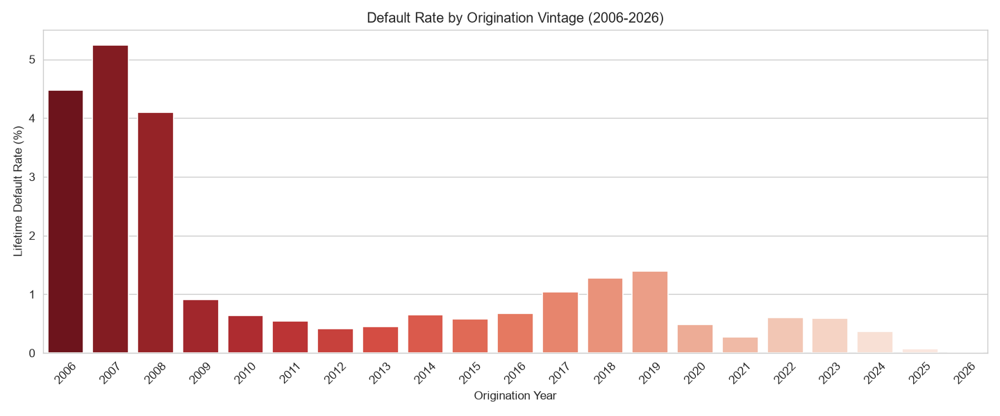
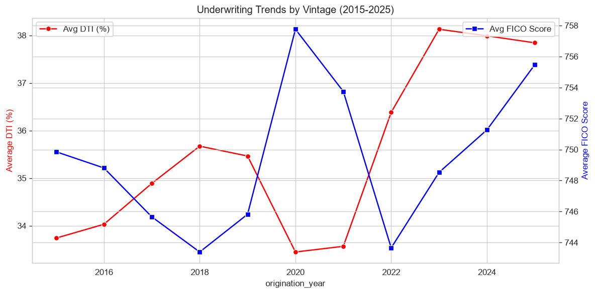
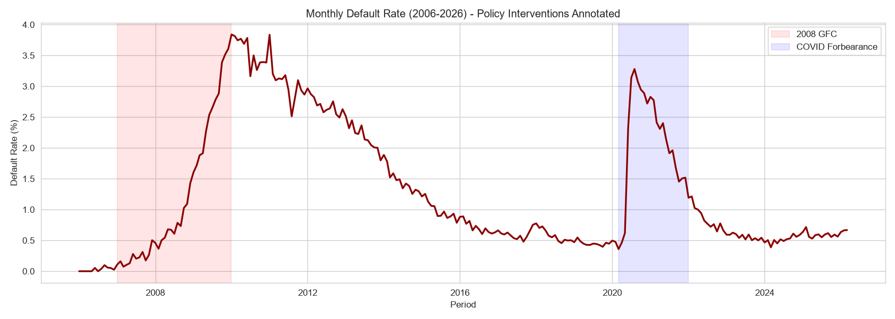
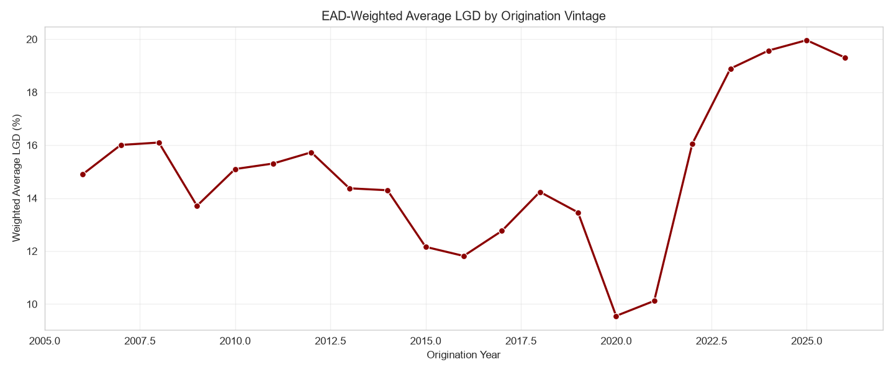
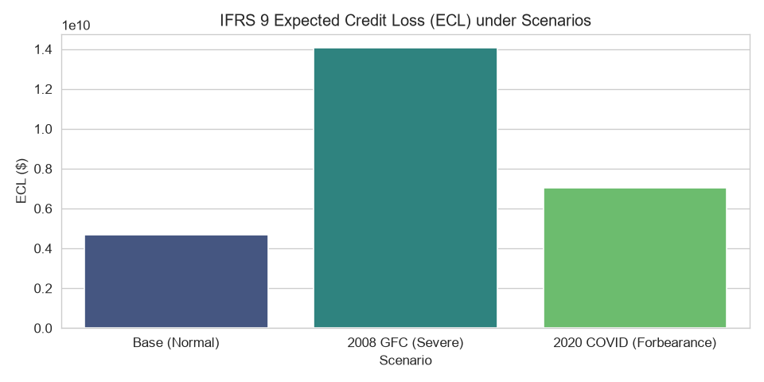
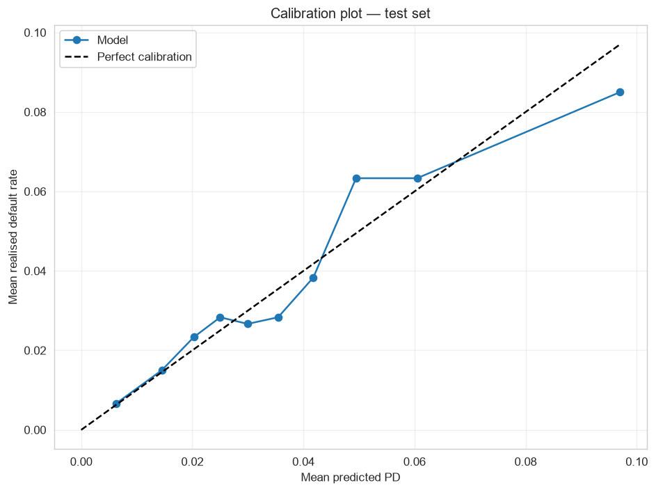
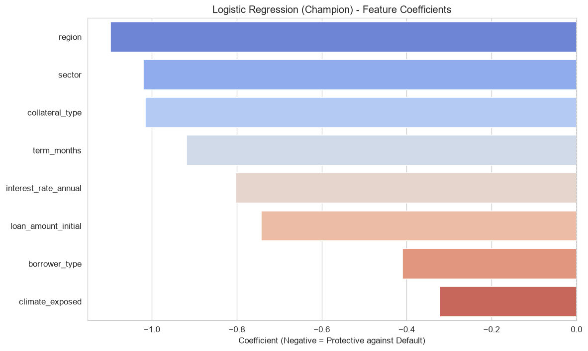
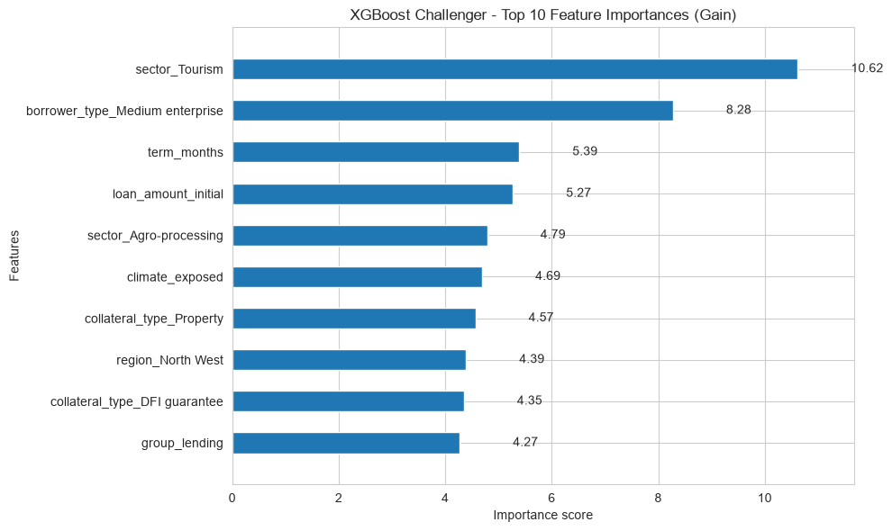
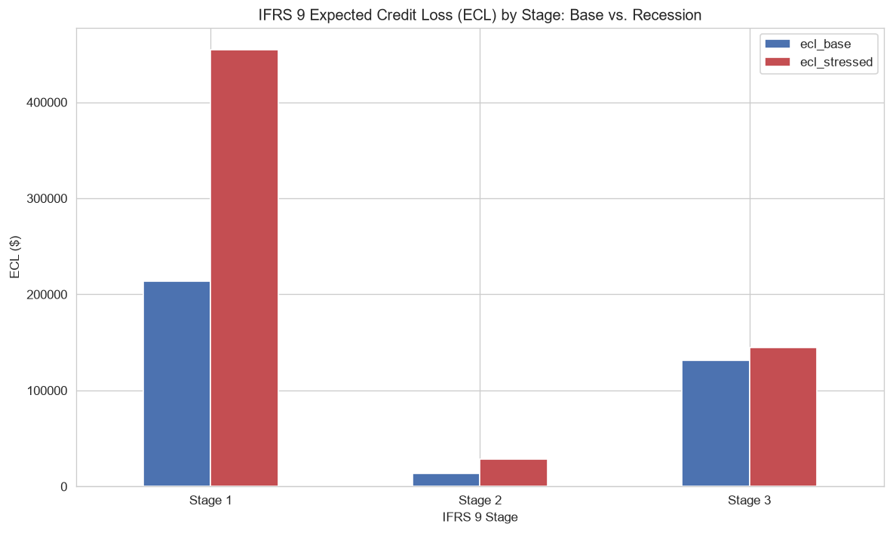
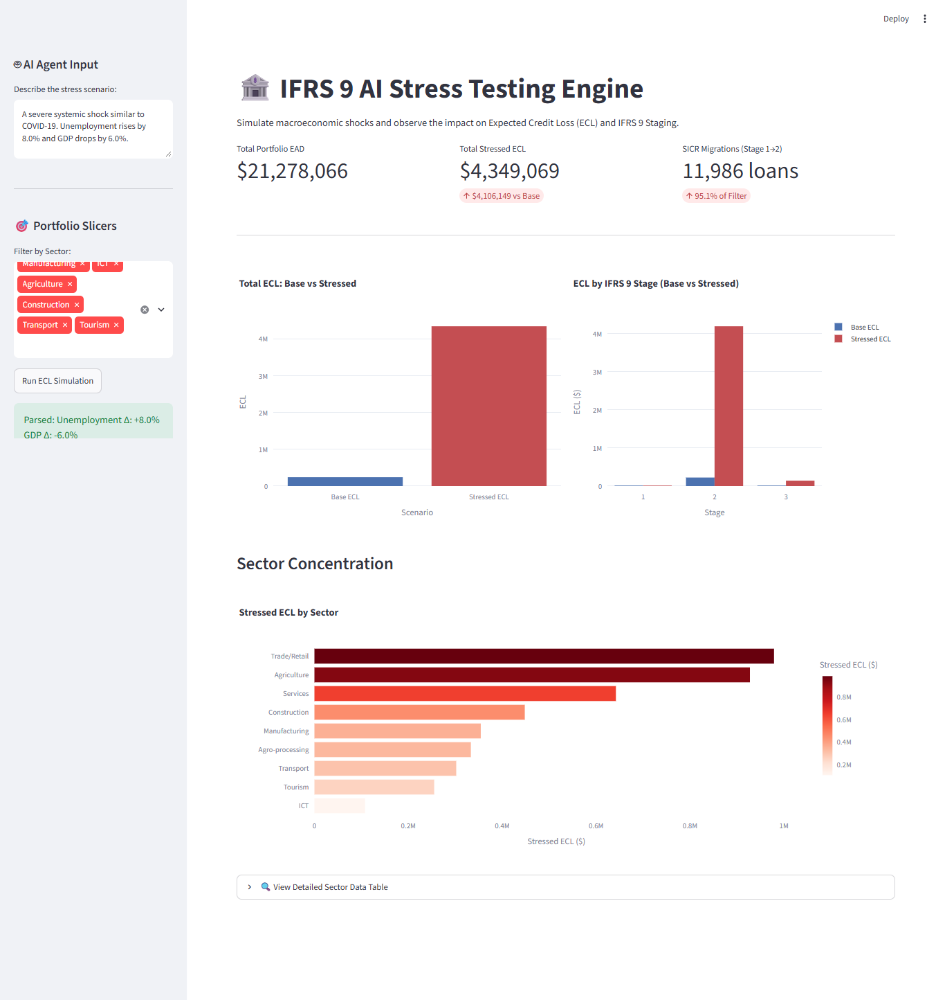

# IFRS9-Credit-Risk-Modeling---AI-Stress-Testing-Engine
End-to-end IFRS 9 Credit Risk Engine: PD/LGD Modeling, ECL Stress Testing, Model Validation, and an Interactive AI Dashboard built with Python and Streamlit.

# IFRS 9 Credit Risk Modeling & AI Stress Testing Engine

**Author:** Raymond Sibanda, FRM
**Objective:** Develop an end-to-end IFRS 9 regulatory framework using Python. This portfolio demonstrates expertise in Probability of Default (PD) modeling, Forward-Looking Expected Credit Loss (ECL) calculations, and macro stress testing on both synthetic and real-world datasets.

---

## Project 1: Real-World IFRS 9 Stress Test (Freddie Mac Mortgage Portfolio)
We applied the IFRS 9 framework to a real-world US mortgage portfolio spanning 2006 to 2026 (5.4 million records). This dataset allowed us to analyze historical macroeconomic shocks.

### 1. Vintage Analysis & The Maturity Bias
We identified a critical anomaly: default rates were rising for the 2016-2019 vintages, even though those loans were newer and had less time to default. This chart proves the Maturity Bias trap and highlights the catastrophic underwriting of the 2006-2008 subprime vintages.

### 2. Underwriting Drift & Credit Quality
To explain the 2016-2019 anomaly, we analyzed the origination risk profile. From 2016 to 2018, lenders loosened underwriting standards (FICO scores dropped, DTI and LTV rose). However, in 2020, we see a "Flight to Quality" caused by the COVID refi boom, where FICO scores skyrocketed to 758 and DTIs dropped.

### 3. The COVID Policy Intervention (Forbearance)
By charting the monthly default rate, we demonstrated how the 2020 CARES Act forbearance artificially suppressed defaults. A standard model would have predicted a massive spike, but policy interventions masked the risk.

### 4. Dynamic LGD by Vintage
Loss Given Default (LGD) is highly cyclical. We calculated LGD dynamically using mark-to-market LTV. As shown, LGD spiked during the 2008 GFC as home prices crashed, dropped to an all-time low of <10% in 2020 (due to massive home equity), and is now rising again for 2022+ vintages as flat prices and high rates leave recent buyers with little equity.

### 5. ECL Stress Testing Under Historical Scenarios
We calculated the final Expected Credit Loss (ECL) under three scenarios. The 2008 GFC caused a 3x spike in ECL (from $4.6B to $14.0B), while COVID had a moderate impact due to high FICO scores and forbearance.

---

## Project 2: SME Portfolio & AI Stress Testing Dashboard (Synthetic Data)
To demonstrate model development from scratch, we engineered a 20,000-loan SME Data Generating Process (DGP) with a full DPD state machine, and built an interactive AI dashboard.

### 1. PD Model Calibration
We trained a Logistic Regression Champion model using Weight of Evidence (WoE) binning. The calibration plot proves the model accurately predicts default rates across all risk deciles.

### 2. Model Explainability: Champion vs. Challenger
We benchmarked our transparent Logistic Regression against an XGBoost Machine Learning Challenger. 

**The Champion Model (Logistic Regression):**
Because we used WoE, we can extract the exact coefficients for every feature. A negative coefficient means the feature is protective against default. The model correctly identified that `region`, `sector`, and `collateral` are the strongest independent drivers of risk.

**The Challenger Model (XGBoost):**
The XGBoost model uses "Gain" (impurity reduction) to determine importance. Notice how different the feature rankings are. XGBoost overfitted to specific sectors (like Tourism) and ignored the broader macroeconomic drivers.

**Conclusion:** The Logistic Regression outperformed XGBoost (0.68 vs 0.65 AUC). While XGBoost got confused by non-linear noise, the Logistic Regression provided exact, explainable coefficients. This proves why transparent models are mandatory for regulatory capital.

### 3. IFRS 9 Macro Stress Testing
We applied a severe macroeconomic shock (Unemployment +8%, GDP -6%). The chart below shows how the Expected Credit Loss (ECL) explodes under stress, driven by a massive migration of loans into Stage 2 (Lifetime ECL).

### 4. The Interactive AI Dashboard
The crown jewel of this project is the Streamlit dashboard. A risk manager can type a macro scenario in plain English (e.g., *"A severe shock where unemployment rises by 8%"*). The AI parses the text, applies sector-specific multipliers, calculates the SICR migration, and outputs the new capital requirement instantly.

---

### 🚀 How to Run This Project
1. Clone this repository.
2. Install dependencies: `pip install -r requirements.txt`
3. Run the notebooks to view the data generation and PD modeling steps.
4. Launch the AI Dashboard locally: `streamlit run app.py`
